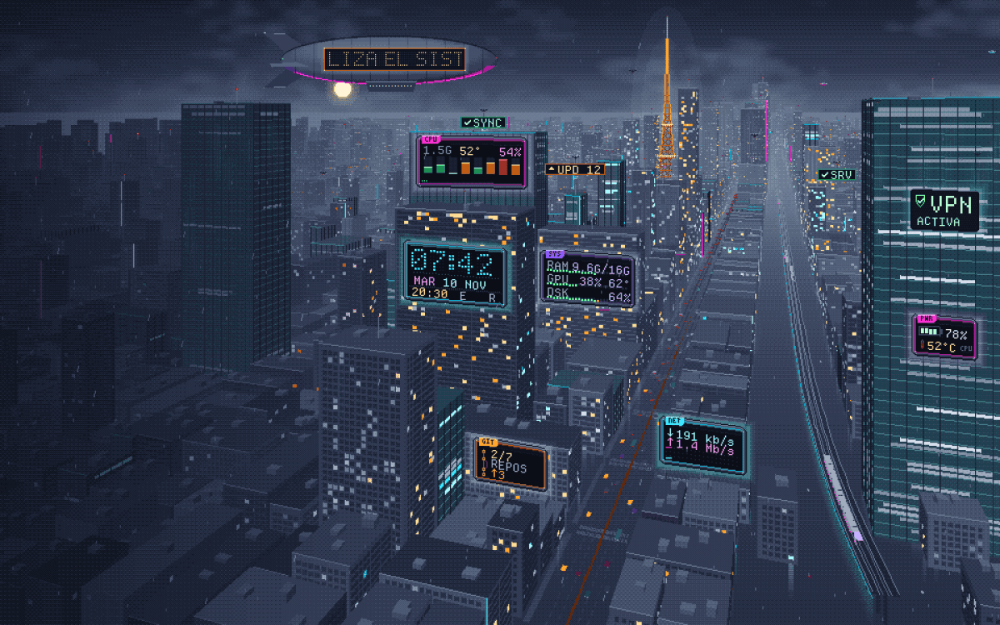
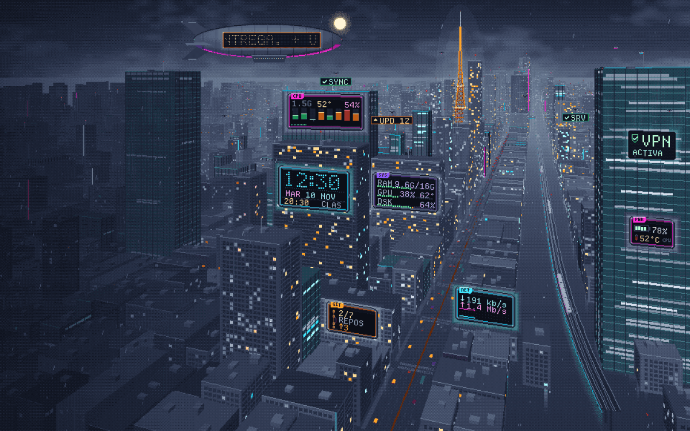
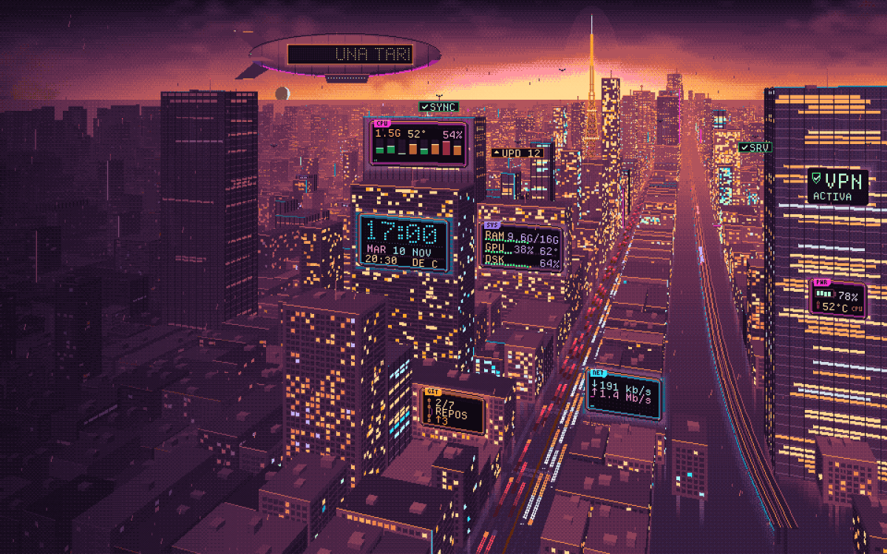
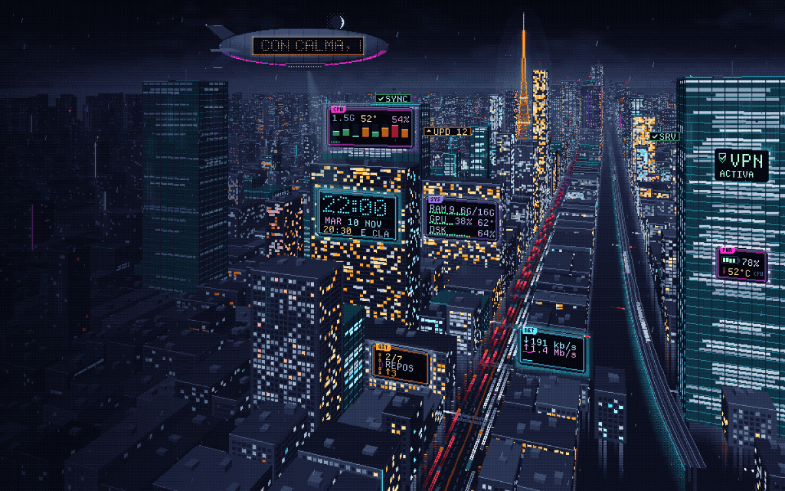

Hace poco te enseñé [PixelZen](), mi escritorio de Japón antiguo. Me quedé con ganas de lo contrario: **una ciudad de noche, con lluvia, mucho neón y ese rollo hacker**. Y con una condición: que no fuera solo decoración. Quería que los carteles de neón fueran **datos de verdad** de mi equipo.

Se llama **NeonGrid**, se instala en un minuto, **no necesita `sudo` ni permisos de nada**, y lo puedes quitar con un clic. Este artículo es el cómo y el porqué, con lo que me salió mal por el camino.



## Si solo quieres instalarlo

Tres pasos, y cuento todo en la sección de instalación más abajo:

1. Descarga el `.tar.gz` desde [GitHub](https://github.com/mosqui1988/neongrid/releases) y descomprímelo.
2. Doble clic en **«Instalar NeonGrid»**.
3. Ya está. Si no te gusta, **«Quitar NeonGrid»** en el menú de aplicaciones y todo vuelve a como estaba.

Necesitas **KDE Plasma 6** (en Plasma 5 no vale, y el instalador lo detecta antes de tocar nada). Todo se queda en tu carpeta personal: no instala nada en el sistema, no usa internet ni pide tu ubicación.

## Qué es

Un tema completo para KDE Plasma 6:

- **Fondo animado:** una ciudad en pixel art con una avenida, un tren elevado, coches, drones, lluvia, niebla y las ventanas de los edificios que se encienden y se apagan.
- **Carteles con datos reales:** CPU por núcleo, RAM, GPU, disco, red, VPN, estado de Syncthing, repos de git con cambios, batería, actualizaciones pendientes, servicios caídos y un reloj con tu agenda.
- **Sol y luna reales:** el sol sale por el horizonte, cruza el cielo y se pone según la hora y la fecha de tu zona; de noche sale la luna, con su fase.
- **Un zepelín** que flota y te va soltando consejos en una pantalla LED.
- **El resto, a juego:** decoración de ventanas, tema de Plasma, iconos, cursor, terminal y la barra superior.



## Antes y después: de la primera idea al resultado

Todo empezó con una imagen de referencia: una ciudad japonesa de noche, mojada, con carteles de neón por todas partes. Quería ese ambiente en pixel art, pero con una diferencia: que cada cartel **dijera algo útil**.

**La primera idea fue una ciudad isométrica**, esas de edificios en cubos vistos desde arriba. Quedaba bien, pero los carteles se veían diminutos y todos los bloques se parecían demasiado entre sí.



**La segunda versión** tenía más edificios y más detalle, pero seguía sin dar la sensación de profundidad de la referencia.



**La buena fue cambiar de enfoque:** pasar a una **vista en perspectiva**, con una avenida que se pierde en el horizonte, un tren elevado, niebla por capas y los carteles como lo más luminoso de toda la escena. Ahí ya se leía todo y se sentía ciudad.



## Un día entero en 10 segundos

El fondo no es una imagen: sigue al sol de tu ciudad. Los cálculos se hacen **en tu equipo** con la fecha y tu zona horaria (si quieres afinar, puedes poner tus coordenadas; no salen de tu ordenador). De ahí sale el modo del cielo (noche, amanecer, día, atardecer), el **sol** y la **luna**, con su fase de verdad.



Cuatro momentos, grabados tal cual (se mueven la lluvia, los coches, el tren, las luces y el zepelín):

| Amanecer | Día |
|---|---|
|  |  |
| **Atardecer** | **Noche** |
|  |  |

Un detalle que me costó: el sol y la luna **salen por detrás de los edificios**. Para eso el sol y la luna no están en la imagen, los dibuja el shader, y solo donde el mapa de profundidad dice «aquí hay cielo». Si no, se pintarían encima de los rascacielos.

## Cómo está hecho

- **Python con Pillow dibuja la ciudad por código**, píxel a píxel: edificios con rampas de cuatro tonos, calle mojada con reflejos, niebla, carteles… Toda la escena usa una **paleta global de 42 colores**, que es lo que le da esa coherencia de pixel art de verdad.
- **Un shader GLSL** hace todo lo que se mueve, a la resolución lógica (960×600): luces de las ventanas, coches, tren, drones, lluvia, balizas y el sol y la luna.
- **QML** pinta lo vivo por encima: el texto de los carteles, la pantalla LED del zepelín y el propio zepelín.
- **Scripts de Python (solo librería estándar)** leen los datos del equipo, **solo lectura** (`/proc`, `/sys`, `git`…), y los entregan en JSON.
- La escena es de 960×600 y se escala por números enteros para que los píxeles queden nítidos.

Mientras lo desarrollaba, cada pieza se probaba en un **KWin virtual aislado**, con su propia carpeta de usuario, para no tocar mi escritorio real. Solo lo instalé en el de verdad cuando ya estaba probado.

## Lo que me salió mal (por si te sirve)

Lo construí **paso a paso con Claude Code**, mirando capturas en cada paso, y casi todos los fallos se vieron ahí, no leyendo código. Algunos reales:

- **Mis capturas de pantallas grandes eran mentira.** Probé 4K y ultrapanorámico, y todo se veía bien... hasta que miré el tamaño de los archivos: 1920×1172. El KWin virtual de pruebas era de 1920×1200 y recortaba cualquier ventana mayor, así que había probado **la misma pantalla cuatro veces** creyendo que eran cuatro. Ahora el tamaño de la pantalla virtual es configurable, y repetí las pruebas de verdad.
- **En pantallas pequeñas (1366×768) la ciudad salía diminuta** en el centro, con un marco oscuro alrededor, porque solo escalaba por enteros. Ahora, si el entero no cubre la pantalla y la escala exacta es menor que 2×, usa esa escala: recorta un poco por la izquierda y abajo, y los carteles se quedan a la vista.
- **Las letras del zepelín salían cortadas.** La pantalla LED tiene una rejilla que solo deja ver 1 de cada 2×2 píxeles, y las letras de una fuente normal tienen trazos finos que se rompían. La solución fue dejar de usar texto y dibujar una **matriz LED 5×7 de verdad**, con los puntos justo donde la rejilla los deja pasar.
- **El instalador dejaba el HUD del otro tema.** Al pasar de PixelZen a NeonGrid, los widgets del anterior se quedaban encima. Ahora el instalador **los desactiva** (no los desinstala) y «Quitar NeonGrid» los devuelve.
- **El fichero de ejemplo de git apagaba la búsqueda automática.** El `repos.txt` de ejemplo, todo comentarios, hacía que el cartel dijera «sin repositorios». Ahora, sin rutas válidas, vuelve a buscarlos solo.
- **Los ficheros «no se abrían».** Los abría con el editor por defecto, y Kate los metía como pestañas en una ventana suya ya abierta que no pasaba al frente. Ahora van en ventanas propias de KDE, que siempre salen delante.

## Se adapta a tu pantalla

| Resolución | Cómo queda |
|---|---|
| 1024×768 · 1280×720 · 1366×768 · 1280×1024 | Escala ajustada (1,3×–1,7×): llena la pantalla |
| 1440×900 · 1600×900 · 1920×1080 · 1920×1200 | 2× entero: pixel perfecto |
| 2560×1440 · 2560×1600 · 3840×2160 | 3×–4× entero: pixel perfecto |
| Ultrapanorámicas (2560×1080, 3440×1440) | La ciudad llena el alto y los lados se rellenan con la ciudad desenfocada. Es el caso más flojo: funciona, pero no luce igual |





## Instalarlo, paso a paso

**Requisitos**

- **KDE Plasma 6.** Lo probé en CachyOS con Plasma 6.8 (Wayland). En otras distribuciones debería funcionar, pero **no lo he probado**: si lo pruebas, cuéntame.
- `python3`, `kconfig` (`kwriteconfig6`) y `fontconfig`. Casi seguro que ya los tienes. Si falta algo, el instalador te dice **el comando exacto** para tu distribución, pero **nunca lo ejecuta él**.
- Opcional: `kdialog` (viene con KDE) para las ventanas del instalador.

**Pasos**

1. Descarga `neongrid-1.0.0.tar.gz` desde [Releases](https://github.com/mosqui1988/neongrid/releases) y extráelo.
2. Doble clic en **«Instalar NeonGrid»** (o `./instalar.sh` en una terminal). Te pregunta qué instalar y **guarda una copia de tus ajustes antes de tocar nada**.
3. El escritorio se reinicia solo unos segundos. Listo.

**Sin `sudo`, sin root, sin red.** Todo va a `~/.local/share` y `~/.config`.

**Qué cambia:** fondo, colores, ventanas, iconos, cursor, tema de Plasma, Konsole, fuentes y la barra superior (la reorganiza). Si tenías widgets de otro tema, los desactiva.

**Para volver atrás:** menú de aplicaciones → **Quitar NeonGrid** (restaura lo que había) o **Desinstalar NeonGrid** (lo borra todo, y te pregunta si quieres borrar también tu agenda).

### Configurarlo sin tocar ficheros

Menú de aplicaciones → **Configurar NeonGrid**. Con ventanas de KDE puedes:

- **Añadir un repo de git** con el selector de carpetas, sin escribir rutas.
- Editar tu **agenda** y los **consejos del zepelín**.
- Poner **tu ciudad** para afinar el amanecer y el atardecer.
- Activar el **modo calma** (menos movimiento).

Si prefieres los ficheros, hay una guía completa en el repositorio.

## Lo que no hace

- **Solo Plasma 6.** No hay versión para GNOME ni para Plasma 5.
- **Solo lo he probado en CachyOS.** El instalador ya contempla Arch, Debian, Fedora y openSUSE para decirte qué paquetes faltan, pero no lo he probado en ellas.
- **La luna sale siempre al anochecer y se pone al amanecer.** Su **fase** es la real, pero su hora de salida está simplificada (la real cambia cada día y se vería salir de madrugada).
- **Los datos de las capturas son de demostración.** El modo demo es un fichero vacío llamado `demo` en `~/.config/neongrid/`.

## Descarga y licencia

- **Código y paquete:** [github.com/mosqui1988/neongrid](https://github.com/mosqui1988/neongrid), con el `.tar.gz` en Releases y su suma SHA-256.
- **Licencia:** GPL-3.0-or-later. Las fuentes (Chakra Petch y Departure Mono) son OFL y mantienen su licencia.
- Si te gustó este, mira su hermano, [PixelZen](), el de Japón antiguo.
